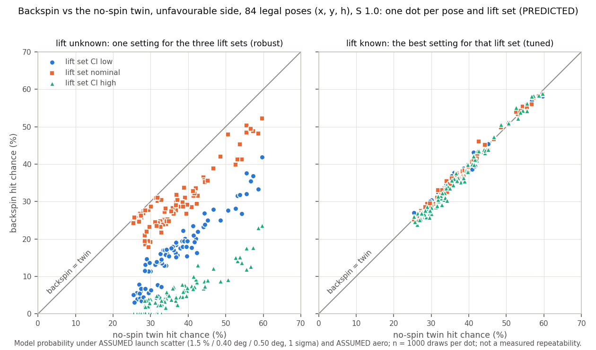

# PM-021: backspin against the no-spin twin, over the whole field

Written 2026-10-31. Code: `src/spin_vs_twin.py` (subcommands run, csv, summary, tables, fig). Data:
`data/spin_vs_twin.csv` (2592 rows). Figure: `figures/spin_vs_twin.png`. Tests: `tests/test_spin_vs_twin.py`.
Paper: section 8, `paper/sections/07_spin_vs_twin.tex`. The tables in sections 3 to 5 are the output of
`python -m src.spin_vs_twin tables`, pasted unchanged.

Labels follow HANDOFF section 5: CONFIRMED / user / ASSUMED / derived / PREDICTED. Every chance here is PREDICTED:
a model probability under ASSUMED launch scatter and ASSUMED aero. It is not a measured repeatability and not a hit
rate. No aero property of POLLEN has been measured. The lift sets are bounds taken from pickleball and smooth-sphere
literature, which are not POLLEN facts. Every backspin chance is shown beside the no-spin twin's chance at the same
pose.

## 1. The answer for the coach

**The question.** One powered 98 mm wheel (user) with a fixed hood always spins the ball. The hood is predicted to
give backspin of about S 1.0 to 1.3 (PREDICTED, `src/launcher.py`). Does that backspin raise the chance of a clean
entry into the upward HIVE cell from the far (unfavourable) side?

The yardstick is the **no-spin twin**: the same ball with no spin and no lift, at its own best setting, scored on
the same simulated shots. The twin is a reference, not a design. "Twin wins" below means that backspin gives no gain
in this model. It does not mean "build a no-spin shooter", which would be a different mechanism (out of scope).

**The answer, in this model.**

1. **Backspin never clearly beats the twin.** At none of the 144 legal poses, on either side, for any spin, lift set
   or search mode is the backspin chance clearly higher than the twin's (0 of 2592 rows, PREDICTED).
2. **If the wheel is tuned to the ball's real lift, backspin and the twin are level.** The far-side median is 34.4 to
   35.7 % with backspin against 35.2 % for the twin (S 1.0, PREDICTED). The two intervals overlap at all 84 far-side
   poses, for each lift set. Backspin is a little lower at most poses (median -0.3 to -1.0 points). That lean is much
   smaller than the +-3 point noise of 1000 shots, so the model cannot tell the two apart.
3. **If the lift is not known, backspin is worse.** One setting that has to work for all three lift guesses gives a
   far-side median of 16.0 % if the real lift is low, 28.4 % if it is nominal and 4.4 % if it is high, against 35.2 %
   for the twin (S 1.0, PREDICTED). The twin is clearly higher at 84, 61 and 84 of the 84 poses. This is the price
   of not knowing POLLEN's lift: 7 to 30 points at the median (PREDICTED). It is not a physical advantage of no spin.
   The twin has no lift to be unsure about, and the drag guess is the same for both shots.
4. **Near side: no difference.** Both shots go in about 99.7 to 99.8 % of the time (PREDICTED).
5. **More spin is not better.** S 1.5 gives exactly the same result as S 1.0 at every pose (864 of 864 rows the same).
   The model's lift is capped for the whole flight once S is above about 0.82 (derived, section 6). Less spin
   (S 0.5) is level with S 1.0 when tuned, and it never beats the twin either.
6. **The best far-side spots** in this grid are the 11 poses on the line nearest the HIVE (x -0.65 m, bearing 37 to
   57 deg off the HIVE line). There the twin reaches 50.6 to 59.7 % and tuned backspin 50.6 to 58.9 % (PREDICTED).

**What to do with it.**

- Do not count on backspin to raise the far-side hit chance. This model gives no sign that it does.
- Tune the shooter on the real ball with test shots instead of trusting a setting from the model. In this model a
  setting picked without knowing the lift costs 7 to 30 points at the median (PREDICTED).
- Measure POLLEN's lift and drag (the twin test in `docs/MEASURE.md`) and the real shot-to-shot scatter. Until then
  every number here is a model guess.
- Count real hits over many shots, with a Wilson interval, before believing any hit rate.

## 2. Method

**Model.** The live solver of the explorer page (`viz/explorer/solver.js`): 3D flight in still air with the robot at
rest, and the 3D cell with its side walls and pentagon roof. Each shot is aimed at the gate centre. Node runs the
solver's fixed steps (pose check, clean grid, candidate list). Python runs the Monte Carlo through the port in
`src/robustness.py`. The tests check that port against the browser at the page's default pose.

**Grid (ASSUMED).**

- x = -0.65, -0.95, -1.25 and -1.55 m on the far side, and +0.65 to +1.55 m on the near side.
- y = -1.2 to 2.0 m in 0.4 m steps.
- Release height h = 0.35, 0.5 and 0.737 m.
- Backspin S = 0.5, 1.0 and 1.5.

That is 216 poses (x, y, h). 144 are scored: 84 on the far side (28 floor spots x 3 heights) and 60 on the near
side (20 x 3). The other 72 are not scored:

- 48 do not fit the 18 in robot footprint (solver.js status illegal).
- 15 have a bearing above the range the model is checked for (psi_extrapolated).
- 9 lie beyond the exported tables (beyond_model).

On the far side, the line x -0.65 m has legal spots only at y -1.2, -0.8, 1.2 and 1.6 m. The near-side line
x +0.65 m has none.

**Three searches per pose.** Each uses the page's best-chance search (solver.js bestChance, stages 1 to 3):

- clean candidate settings at or below the 8.9 m/s grip cap (PREDICTED): up to 24 grid settings, plus the
  tolerant lowest-rpm and lowest-hood settings and the most forgiving one (solver.js bcCandidates), 64 shots each.
  Here a search had 17 to 27 candidates (derived);
- the best (up to 5) at 400 shots;
- then the winner on 1000 fresh shots.

All three stages use common random numbers with seed 20261031. Of the 1872 searches (144 poses x 13, derived),
18 picked one of the three named settings (9 lowest hood, 9 most forgiving; PREDICTED) and the rest a grid
setting.

| search | spin and lift | setting | stands for |
|---|---|---|---|
| twin | S 0, no lift | best for the twin, from its own clean grid | the yardstick |
| robust (S) | S, the three lift sets pooled with equal weight (ASSUMED) | one setting from the nominal set's clean grid, scored over all three sets and reported per set | a setting picked without knowing the lift |
| tuned (S, L) | S, one lift set L | best for set L alone, from that set's clean grid | a setting picked after the lift is measured, or tuned on a ball whose lift is L |

At each pose the twin and every backspin winner are scored on the same 1000 fresh shots, so the pair is matched.

**Aero (ASSUMED, `research/params_lit.json`).**

- Drag: Cd 0.5 for every shot.
- Lift: Cl = min(c1 S, Clmax), with (c1, Clmax) = (0.2, 0.15) for Cl_low, (0.35, 0.25) for nominal and (0.8, 0.4)
  for Cl_high.
- Spin decay: k 0.03 1/s.

**Launch scatter (ASSUMED, 1 sigma, Gaussian).** Exit speed 1.5 %, elevation 0.40 deg and heading 0.50 deg. The
spin itself has no scatter.

**Score.** Clean entry only: the ball enters without touching the rim or the walls. Bounce-ins and retention are
not scored.

**Verdict.** Each chance gets a Wilson 95 % interval:

- **spin > twin**: the backspin interval lies wholly above the twin's;
- **twin > spin**: the backspin interval lies wholly below the twin's;
- **unclear**: the two intervals overlap.

At a chance near 35 % and 1000 shots the interval is about +-3 points wide on each side (derived), so a verdict
needs a gap of about 6 points. dp is the backspin chance minus the twin's at the same pose, on the same shots, in
percentage points (pp).

**Wheel rpm** (Table 5) = 60 v / (0.42 x pi x 0.098 m). It uses the ASSUMED grip v/u 0.42 and the 98 mm wheel
(user).

## 3. Backspin against the twin at every pose

The S 1.5 rows are identical to the S 1.0 rows in 864/864 pairs (same setting, counts, interval and verdict), so the
tables show them once as "1.0 = 1.5". No row has the verdict "neither" (no chance either way).

**Table 1a.** unfavourable side: backspin vs the no-spin twin per mode, S and lift set (PREDICTED; twin = S 0, no
lift, its own best setting, same draws)

| mode | S | lift set | poses | spin > twin | twin > spin | unclear | backspin median (max) % | twin median (max) % | dp median [min, max] pp | dp > 0 / < 0 | poses >= 50 %: backspin / twin |
|---|---|---|---:|---:|---:|---:|---:|---:|---:|---:|---:|
| robust | 0.5 | Cl_low | 84 | 0 | 84 | 0 | 18.0 (43.5) | 35.2 (59.7) | -18.5 [-26.7, -11.7] | 0 / 84 | 0 / 11 |
| robust | 0.5 | nominal | 84 | 0 | 43 | 41 | 30.6 (49.7) | 35.2 (59.7) | -5.8 [-13.0, 0.6] | 1 / 83 | 0 / 11 |
| robust | 0.5 | Cl_high | 84 | 0 | 84 | 0 | 1.0 (14.7) | 35.2 (59.7) | -34.0 [-47.9, -25.4] | 0 / 84 | 0 / 11 |
| robust | 1.0 = 1.5 | Cl_low | 84 | 0 | 84 | 0 | 16.0 (41.9) | 35.2 (59.7) | -20.4 [-27.5, -14.3] | 0 / 84 | 0 / 11 |
| robust | 1.0 = 1.5 | nominal | 84 | 0 | 61 | 23 | 28.4 (52.2) | 35.2 (59.7) | -8.1 [-13.0, 0.2] | 1 / 83 | 2 / 11 |
| robust | 1.0 = 1.5 | Cl_high | 84 | 0 | 84 | 0 | 4.4 (23.6) | 35.2 (59.7) | -31.4 [-44.0, -24.8] | 0 / 84 | 0 / 11 |
| tuned | 0.5 | Cl_low | 84 | 0 | 0 | 84 | 34.8 (58.9) | 35.2 (59.7) | -0.6 [-2.6, 3.0] | 24 / 56 | 12 / 11 |
| tuned | 0.5 | nominal | 84 | 0 | 0 | 84 | 34.7 (58.7) | 35.2 (59.7) | -0.9 [-3.1, 3.7] | 17 / 66 | 11 / 11 |
| tuned | 0.5 | Cl_high | 84 | 0 | 0 | 84 | 34.4 (58.9) | 35.2 (59.7) | -1.0 [-3.9, 2.5] | 18 / 65 | 12 / 11 |
| tuned | 1.0 = 1.5 | Cl_low | 84 | 0 | 0 | 84 | 35.7 (58.3) | 35.2 (59.7) | -0.3 [-2.3, 3.3] | 29 / 51 | 12 / 11 |
| tuned | 1.0 = 1.5 | nominal | 84 | 0 | 0 | 84 | 35.3 (58.6) | 35.2 (59.7) | -0.5 [-2.5, 3.4] | 20 / 62 | 11 / 11 |
| tuned | 1.0 = 1.5 | Cl_high | 84 | 0 | 0 | 84 | 34.4 (58.9) | 35.2 (59.7) | -1.0 [-3.9, 2.5] | 18 / 65 | 12 / 11 |

**Table 1b.** favourable side: backspin vs the no-spin twin per mode, S and lift set (PREDICTED; twin = S 0, no lift,
its own best setting, same draws)

| mode | S | lift set | poses | spin > twin | twin > spin | unclear | backspin median (max) % | twin median (max) % | dp median [min, max] pp | dp > 0 / < 0 | poses >= 50 %: backspin / twin |
|---|---|---|---:|---:|---:|---:|---:|---:|---:|---:|---:|
| robust | 0.5 | Cl_low | 60 | 0 | 0 | 60 | 99.7 (100.0) | 99.8 (100.0) | 0.0 [-0.7, 0.2] | 14 / 25 | 60 / 60 |
| robust | 0.5 | nominal | 60 | 0 | 0 | 60 | 99.8 (100.0) | 99.8 (100.0) | 0.0 [-0.6, 0.3] | 22 / 19 | 60 / 60 |
| robust | 0.5 | Cl_high | 60 | 0 | 3 | 57 | 99.8 (100.0) | 99.8 (100.0) | 0.0 [-2.0, 0.4] | 21 / 27 | 60 / 60 |
| robust | 1.0 = 1.5 | Cl_low | 60 | 0 | 0 | 60 | 99.7 (100.0) | 99.8 (100.0) | 0.0 [-0.9, 0.2] | 11 / 23 | 60 / 60 |
| robust | 1.0 = 1.5 | nominal | 60 | 0 | 0 | 60 | 99.8 (100.0) | 99.8 (100.0) | 0.0 [-1.0, 0.3] | 24 / 19 | 60 / 60 |
| robust | 1.0 = 1.5 | Cl_high | 60 | 0 | 0 | 60 | 99.8 (100.0) | 99.8 (100.0) | 0.0 [-1.2, 0.4] | 21 / 24 | 60 / 60 |
| tuned | 0.5 | Cl_low | 60 | 0 | 0 | 60 | 99.8 (100.0) | 99.8 (100.0) | 0.0 [-0.4, 0.2] | 13 / 16 | 60 / 60 |
| tuned | 0.5 | nominal | 60 | 0 | 0 | 60 | 99.7 (100.0) | 99.8 (100.0) | 0.0 [-0.6, 0.3] | 15 / 20 | 60 / 60 |
| tuned | 0.5 | Cl_high | 60 | 0 | 0 | 60 | 99.7 (100.0) | 99.8 (100.0) | 0.0 [-0.9, 0.3] | 19 / 23 | 60 / 60 |
| tuned | 1.0 = 1.5 | Cl_low | 60 | 0 | 0 | 60 | 99.7 (100.0) | 99.8 (100.0) | 0.0 [-0.6, 0.2] | 11 / 17 | 60 / 60 |
| tuned | 1.0 = 1.5 | nominal | 60 | 0 | 0 | 60 | 99.7 (100.0) | 99.8 (100.0) | 0.0 [-0.6, 0.3] | 14 / 19 | 60 / 60 |
| tuned | 1.0 = 1.5 | Cl_high | 60 | 0 | 0 | 60 | 99.7 (100.0) | 99.8 (100.0) | 0.0 [-0.9, 0.3] | 19 / 23 | 60 / 60 |

*Figure.* Far side, S 1.0 (= 1.5). Each dot is one legal pose (x, y, h). The x axis is the twin's chance and the
y axis the backspin chance. Left panel: robust (lift unknown). Right panel: tuned (lift known). Colour and marker
show the lift set. A dot on the diagonal means backspin = twin. PREDICTED, under ASSUMED scatter and ASSUMED aero.

What the tables say (all PREDICTED):

- **Far side, tuned: level with the twin.** All 84 poses are unclear, for every set and every S. The medians are
  34.4 to 35.7 % against 35.2 %. The matched dp leans slightly negative at S 1.0: median -0.3 pp for Cl_low, -0.5 for
  nominal and -1.0 for Cl_high, with backspin lower at 51, 62 and 65 of the 84 poses. The full range at S 1.0 is
  -3.9 to +3.4 pp. All poses use the same seeded shots, so these counts are not 84 independent tests, and the lean
  is not resolved.
- **Far side, robust: below the twin.** At S 1.0 the twin is clearly higher at all 84 poses for Cl_low and Cl_high,
  and at 61 poses for nominal (23 unclear). Backspin reaches 50 % at 2 poses (nominal set only); the twin at 11.
- **Near side: the same.** The two shots are within about 2 points of each other at every pose. Only robust S 0.5
  with Cl_high has 3 poses where the twin is clearly higher (backspin 97.9 to 98.6 % against 99.8 to 99.9 %).
- On the far side the twin's chance ranges from 25.4 to 59.7 % over the 84 poses.

## 4. Where on the far side

Tables 3a and 3b split the robust nominal case at S 1.0 by release height and by distance. The twin is clearly
higher at more poses as the release height rises (15, 19 and 27 of 28). By distance it is clearly higher at 10 of 24
poses at x -1.55 m, at 19 and 22 of 24 at x -1.25 and -0.95 m, and at 10 of 12 at x -0.65 m.

**Table 3a.** unfavourable side, robust, S 1.0, nominal lift set, by release height h (m) (PREDICTED)

| h | poses | twin > spin | unclear | spin > twin | backspin median % | twin median % |
|---:|---:|---:|---:|---:|---:|---:|
| 0.35 | 28 | 15 | 13 | 0 | 29.1 | 34.1 |
| 0.5 | 28 | 19 | 9 | 0 | 28.1 | 35.8 |
| 0.737 | 28 | 27 | 1 | 0 | 27.7 | 36.0 |

**Table 3b.** unfavourable side, robust, S 1.0, nominal lift set, by field x (m; distance d = |x|) (PREDICTED)

| x | poses | twin > spin | unclear | spin > twin | backspin median % | twin median % |
|---:|---:|---:|---:|---:|---:|---:|
| -1.55 | 24 | 10 | 14 | 0 | 24.8 | 28.4 |
| -1.25 | 24 | 19 | 5 | 0 | 27.0 | 33.7 |
| -0.95 | 24 | 22 | 2 | 0 | 31.3 | 40.3 |
| -0.65 | 12 | 10 | 2 | 0 | 48.0 | 54.9 |

All 11 far-side poses where the twin reaches 50 % are on the line x -0.65 m (Table 4). There the tuned backspin shot
is level with the twin at every pose and for every set. The robust shot is clearly lower at 31 of the 33 pose and set
pairs.

**Table 4.** unfavourable poses with a twin chance >= 50 %, S 1.0: backspin chance per lift set beside the twin
(PREDICTED). (T) = backspin interval wholly below the twin's (twin > spin), (B) = wholly above, no mark = the
intervals overlap (unclear)

| x | y | h | d | psi deg | twin % [Wilson 95 %] | robust Cl_low | robust nominal | robust Cl_high | tuned Cl_low | tuned nominal | tuned Cl_high |
|---:|---:|---:|---:|---:|---:|---:|---:|---:|---:|---:|---:|
| -0.65 | -1.2 | 0.35 | 0.65 | -48.8 | 54.3 [51.2, 57.4] | 26.8 (T) | 41.3 (T) | 13.7 (T) | 55.2 | 55.3 | 54.4 |
| -0.65 | -1.2 | 0.5 | 0.65 | -48.8 | 55.5 [52.4, 58.6] | 32.0 (T) | 50.3 | 11.9 (T) | 55.2 | 55.8 | 56.2 |
| -0.65 | -1.2 | 0.737 | 0.65 | -48.8 | 57.3 [54.2, 60.3] | 36.9 (T) | 48.8 (T) | 17.7 (T) | 57.7 | 57.7 | 58.2 |
| -0.65 | -0.8 | 0.5 | 0.65 | -37.3 | 50.6 [47.5, 53.7] | 27.6 (T) | 47.9 | 9.1 (T) | 51.1 | 50.6 | 51.0 |
| -0.65 | -0.8 | 0.737 | 0.65 | -37.3 | 53.1 [50.0, 56.2] | 31.5 (T) | 41.3 (T) | 14.1 (T) | 53.1 | 53.3 | 52.2 |
| -0.65 | 1.2 | 0.35 | 0.65 | 48.8 | 52.6 [49.5, 55.7] | 28.1 (T) | 39.9 (T) | 15.1 (T) | 53.7 | 54.0 | 55.1 |
| -0.65 | 1.2 | 0.5 | 0.65 | 48.8 | 53.7 [50.6, 56.8] | 31.8 (T) | 45.3 (T) | 15.2 (T) | 54.1 | 54.2 | 53.9 |
| -0.65 | 1.2 | 0.737 | 0.65 | 48.8 | 55.5 [52.4, 58.6] | 37.6 (T) | 48.4 (T) | 17.5 (T) | 55.4 | 55.2 | 54.2 |
| -0.65 | 1.6 | 0.35 | 0.65 | 56.7 | 56.7 [53.6, 59.7] | 35.5 (T) | 49.4 (T) | 12.7 (T) | 56.9 | 56.0 | 58.1 |
| -0.65 | 1.6 | 0.5 | 0.65 | 56.7 | 58.7 [55.6, 61.7] | 33.3 (T) | 48.2 (T) | 23.0 (T) | 58.3 | 58.1 | 58.4 |
| -0.65 | 1.6 | 0.737 | 0.65 | 56.7 | 59.7 [56.6, 62.7] | 41.9 (T) | 52.2 (T) | 23.6 (T) | 58.1 | 58.6 | 58.9 |

**Table 5.** unfavourable side, S 1.0: median winning setting over the legal poses (PREDICTED; rpm at the ASSUMED
grip v/u 0.42)

| shot | median v (m/s) | median elevation (deg) | median wheel rpm |
|---|---:|---:|---:|
| backspin, robust (one setting for all lift sets) | 7.20 | 74.8 | 3341 |
| backspin, tuned for Cl_low | 8.50 | 78.2 | 3944 |
| backspin, tuned for nominal | 8.50 | 77.4 | 3944 |
| backspin, tuned for Cl_high | 8.40 | 76.0 | 3898 |
| no-spin twin (its own best setting) | 8.50 | 79.6 | 3944 |

The robust setting is slower and flatter than the tuned settings and the twin's (PREDICTED). One possible reason,
not tested: the Magnus force grows with the square of the speed, so the three lift sets disagree less on a slower
shot.

## 5. The cost of not knowing the lift

Table 2 compares two settings at the same pose: the one picked without knowing the lift (robust) and the one picked
for the true lift (tuned).

**Table 2.** Cost of not knowing the lift: tuned minus robust backspin chance at the same pose (PREDICTED)

| side | S | true lift set | poses | robust median % | tuned median % | twin median % | tuned - robust median [min, max] pp | poses with robust interval wholly below tuned |
|---|---|---|---:|---:|---:|---:|---:|---:|
| unfavourable | 0.5 | Cl_low | 84 | 18.0 | 34.8 | 35.2 | 18.2 [10.8, 27.9] | 84 |
| unfavourable | 0.5 | nominal | 84 | 30.6 | 34.7 | 35.2 | 4.8 [-1.8, 12.4] | 33 |
| unfavourable | 0.5 | Cl_high | 84 | 1.0 | 34.4 | 35.2 | 32.8 [23.9, 48.6] | 84 |
| unfavourable | 1.0 = 1.5 | Cl_low | 84 | 16.0 | 35.7 | 35.2 | 20.1 [14.3, 28.4] | 84 |
| unfavourable | 1.0 = 1.5 | nominal | 84 | 28.4 | 35.3 | 35.2 | 7.3 [0.0, 14.4] | 56 |
| unfavourable | 1.0 = 1.5 | Cl_high | 84 | 4.4 | 34.4 | 35.2 | 30.1 [21.7, 45.4] | 84 |
| favourable | 0.5 | Cl_low | 60 | 99.7 | 99.8 | 99.8 | 0.0 [-0.2, 0.6] | 0 |
| favourable | 0.5 | nominal | 60 | 99.8 | 99.7 | 99.8 | 0.0 [-0.4, 0.4] | 0 |
| favourable | 0.5 | Cl_high | 60 | 99.8 | 99.7 | 99.8 | 0.0 [-0.4, 1.6] | 1 |
| favourable | 1.0 = 1.5 | Cl_low | 60 | 99.7 | 99.7 | 99.8 | 0.0 [-0.1, 0.8] | 0 |
| favourable | 1.0 = 1.5 | nominal | 60 | 99.8 | 99.7 | 99.8 | 0.0 [-0.3, 0.6] | 0 |
| favourable | 1.0 = 1.5 | Cl_high | 60 | 99.8 | 99.7 | 99.8 | 0.0 [-0.4, 0.9] | 0 |

On the far side at S 1.0 the median cost is 20.1 points if the true lift is Cl_low, 7.3 if it is nominal and 30.1 if
it is Cl_high (PREDICTED). The robust interval lies wholly below the tuned one at 84, 56 and 84 of the 84 poses. On
the near side there is no cost.

How to read it:

- **The robust search pools only the lift uncertainty.** The twin has no lift, so it has nothing to pool, and Cd is
  held at 0.5 for both shots. So "twin > robust backspin" measures the cost of the unknown lift. It does not show
  that a ball without spin flies better. If Cd were also unknown, both shots would pay for it; that case was not run.
- **Tuning removes the cost in the model.** Tuned backspin is level with the twin (section 3). On a real field this
  means tuning on the real ball, or measuring its lift first.
- **The cost is smallest for the nominal set.** The robust candidates come from the nominal set's clean grid
  (section 2), which likely favours that set. The cost is largest when the true lift is far from nominal (Cl_high,
  then Cl_low).

## 6. Why S 1.5 gives the same answer as S 1.0

The S 1.5 searches equal their S 1.0 partners exactly: 576 of 576 searches have the same setting and the same
counts, so 864 of 864 CSV rows are the same. The reason is the capped lift law. Step by step (all derived; this holds
for the model, not necessarily for POLLEN):

1. In still air the Magnus force is at right angles to the velocity, so it does no work. Only gravity and drag do
   work, and drag only removes energy. So 1/2 v^2 + g z never increases along the flight.
2. A shot is followed from release until it falls back to 0.4 m above the release height (the integrator stop). The
   stop is min(0.4 m, lowest cell point - 0.05 m - h) above release, which is 0.4 m for every h in the grid (lowest
   cell point 1.252 m, derived). On that whole stretch the ball is at or above the release height, so its speed is
   at or below the exit speed v0.
3. The spin decays as omega0 e^(-k t), so S(t) = S0 e^(-k t) v0 / v(t) >= S0 e^(-k t). The integration stops at
   3.0 s at the latest, so S(t) >= S0 e^(-0.09) = 0.914 S0.
4. The lift reaches its cap at S_sat = Clmax / c1: 0.75 for Cl_low, 0.714 for nominal and 0.5 for Cl_high. For
   S0 >= 0.75 / 0.914 = 0.82, all three sets sit at their cap for the whole flight.
5. At the cap the lift force no longer depends on the spin rate. Drag is a constant Cd 0.5, the launch scatter has
   no spin part, and the score depends only on the path. So S0 1.0 and S0 1.5 fly the same paths on the same shots
   and score the same.

The same happens one step lower for Cl_high alone. Its cap is reached at S 0.5, and the tuned Cl_high rows at S 0.5
equal the S 1.0 rows at 144 of 144 poses. Most other S 0.5 rows differ (tuned: 128 of 144 for Cl_low and 138 of
144 for nominal), because there the lift stays below its cap for part of the flight.

S 0.5 against S 1.0 (far side, PREDICTED, twin 35.2 % throughout):

- tuned medians: 34.4 to 34.8 % at S 0.5, against 34.4 to 35.7 % at S 1.0;
- robust medians (Cl_low / nominal / Cl_high): 18.0 / 30.6 / 1.0 % at S 0.5, against 16.0 / 28.4 / 4.4 % at S 1.0.

Less spin moves the robust medians a few points up or down, depending on the set. Neither S beats the twin.

The cap is a model assumption (paper section 3.6, "The lift law and its saturation"). A real perforated ball may keep
gaining lift above S 0.82, may show a lift dip, or may gain drag with spin. Any of these would make the spin rate
matter again, in either direction. So "S 1.5 = S 1.0" is a statement about the model, not about POLLEN.

## 7. Limits

- **Aero is ASSUMED.** Cd and the three lift sets are bounds from pickleball and smooth-sphere literature, not
  POLLEN measurements. POLLEN is perforated, so its lift may be well below the smooth-sphere values. The CFD study
  (PM-012, `cfd/`) has not produced a POLLEN lift yet. When it does, or when the twin test is done, the lift sets
  may move, and with them every number here.
- **Drag does not depend on spin here.** Cd is 0.5 for both shots. The spin-raised drag option (`MISSING_EFFECTS.md`
  item 14, off by default) acts on the backspin shot only and was not switched on.
- **Scatter is ASSUMED and the same for both shots.** There is no spin scatter. A real hood's spin will vary from
  shot to shot. In the model this would not matter while the lift stays capped, but on a ball whose lift keeps
  rising with S it would add scatter to the backspin shot only.
- **Clean entry only.** Bounce-ins and retention are not scored. Unreviewed team build threads
  (`research/sweeps/sweep_pollen.md`) report that backspin raises bounce-outs from the CELL, and the contact model
  (paper section 5) finds that backspin can lower retention. Neither is in these chances.
- **The grid is coarse and ASSUMED.** It has 0.3 m steps in x and 0.4 m in y. 72 of the 216 poses are not scored.
  The nearest far-side line is x -0.65 m, so closer spots are not sampled. At 33 of the 84 far-side poses the
  straight line to the aim point crosses the other HIVE, which is not modelled as an obstacle (a high ball can pass
  above it).
- **Still air, robot at rest.** Drafts, robot motion, exit skew and sidespin are not included.
- **Tuned means tuned exactly.** The tuned search knows the true lift set. Tuning by test shots on a real field has
  its own noise, which is not modelled.
- **Matched shots.** All poses use the same seeded shots, so the 84 far-side poses are not 84 independent tests.
  The small tuned lean (backspin lower at 51 to 65 of 84 poses) is not evidence either way.
- **A model chance, not a hit rate** (HANDOFF 5). Nothing here says how often a real shooter will score.

## 8. What measurement would change the answer

1. **POLLEN lift Cl(S) and drag Cd.** The twin test (shot A without spin, shot B with backspin; `docs/MEASURE.md`,
   `viz/measure/`). It decides which tuned row applies and removes the cost of not knowing the lift. If the real
   lift keeps rising above S 0.82, the spin rate matters again, and tuned backspin could move away from the twin in
   either direction.
2. **The real exit spin S of the hood**, from video of a striped ball. S at or above 0.82 puts the shot in the
   S 1.0 rows; S near 0.5 puts it in the S 0.5 rows.
3. **The real launch scatter**: exit speed, elevation and heading over about 20 shots at one setting, and the spin
   scatter. Every chance here depends on it.
4. **Retention after a contact**: restitution and friction on the HIVE material (`docs/07_test_plan.md`). These are
   needed to score bounce-ins and bounce-outs, which team reports (unreviewed) say go against backspin.
5. **The real hit rate** at the tuned setting, with a Wilson interval from many shots, for the shooter as built.

For the verdict to become "spin > twin" anywhere, the backspin interval would have to lie wholly above the twin's.
Near a 35 % chance that needs a gap of about 6 points (derived). The largest tuned gap in this sweep is +3.7 points
(PREDICTED: S 0.5, nominal set, x -0.95 m, y -1.2 m, h 0.737 m, 46.3 % against the twin's 42.6 %, unclear). At
S 1.0 (= 1.5) the largest is +3.4 points, at the same pose and set (46.0 % against 42.6 %, PREDICTED).
