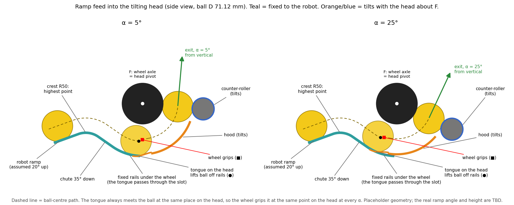

# Ramp feed into the tilting head (Head A, Concept A)

Status 2026-11-07: modelled in Onshape and swept over 20 configurations with no clash between real parts.
2026-11-08: actuator placeholders added (angle servo + pinion + gear sector, and a servo-driven crest gate). They were
checked at α 5, 15 and 25 with the gate closed and open: no clash (section 7).
The physics numbers below are hand estimates (TBD). The ramp angle and position are placeholders until the real robot
ramp is known.

`ramp_feed_diagram.png` is drawn by `ramp_feed_diagram.py` from the same formulas as the FeatureScript. Run
`python ramp_feed_diagram.py out.png` to redraw it; the script also prints the handoff numbers used below.

## 1. Short answer

The ramp does not feed the moving hood directly. It feeds a **fixed** track, and a part of the **moving** head
picks the ball up from that track.

1. The robot ramp carries the ball **up** to a small rounded crest. The crest is the highest point of the feed.
2. Past the crest the ball rolls **down** a short 35° chute onto two fixed rails that curve under the main wheel.
   The rails are arcs centred on the wheel axle, which is also the head's tilt pivot.
3. A narrow **tongue** on the front of the hood runs inside the slot between the rails. The tongue lifts the ball off
   the rails and presses it into the main wheel. The wheel grips it and carries it around the hood to the nip.

Because the rails are centred on the tilt pivot, tilting the head only slides the tongue along the rails. The tongue
meets the ball the same way at every angle from 5° to 25°, and the fixed parts never have to move.

## 2. The problem

Tilting the head from α 5° to α 25° (exit angle from vertical) rotates the hood, the counter-roller and the hood
entrance 20° about the wheel axle.

- The hood entrance moves along an arc of about **43 mm**: a 20° chord at the tongue entry radius of 123.3 mm.
- For a nominal ball, the point where the wheel first grips moves about **29 mm** (20° at the 83.6 mm ball-centre
  radius).

A ramp end fixed to the robot cannot meet an entrance that moves 43 mm. A ramp end that tilts with the head would need
its own joint or a flexible section.

## 3. How the handoff works

Angles in this section are measured about the wheel axle: 0° points downrange and −90° points straight down.

| Step | Part | Fixed or tilts | Default geometry |
|---|---|---|---|
| 1 | Robot ramp (a 60 mm stub is modelled) | fixed | 20° up (assumed) |
| 2 | Crest | fixed | convex, R 50 mm; its top is 131 mm behind and 67 mm below the wheel axle |
| 3 | Chute | fixed | 40 mm long, 35° down, tangent to the rails |
| 4 | Transfer rails | fixed | two rails 20 mm apart on an arc of R 121.3 mm about the axle, from −125° to −93° |
| 5 | Tongue (lead-in on the hood) | tilts | 16 mm wide, 20° long; rises smoothly from 0.5 mm below the ball to the hood surface |
| 6 | Hood + main wheel | hood tilts | the hood carries the ball to the nip as before |

The ramp, crest and chute are one printed part, "Feed floor". It has side walls 44 mm high (TBD) and a 3 mm keel
under the slot that ties the two rails together. Around the wheel the slot is open underneath, so the tongue can
pass through it. The rail end has a bracket. Its tabs pass outside the head side plates to the frame plates; the
mounts are TBD.

The ball rides on the two rail edges, so it sits 1.4 mm lower than on a flat floor. On the rails it clears the main
wheel by:

| Ball | D (mm) | Gap to main wheel on the rails |
|---|---|---|
| smallest | 68.58 | 6.19 mm |
| nominal | 71.12 | 3.59 mm |
| largest | 73.66 | 1.00 mm (set by design) |

The ball is never pinched between a fixed part and a moving part. It rolls freely on the rails until the tongue lifts
it.

Where the handoff happens:

| α | Tongue entry | Nominal ball lifted off the rails | Wheel grips the nominal ball |
|---|---|---|---|
| 5° (stop) | −100.2° | −95.9° | −90.5° |
| 15° | −110.2° | −105.9° | −100.5° |
| 25° (stop) | −120.2° | −115.9° | −110.5° |

Relative to the head, the lift and grip points never change. The wheel grips the ball 9.7° after the tongue entry
for a nominal ball, 13.8° for the smallest and 5.5° for the largest. The ball enters the hood with the same wrap and
the same squeeze at every α.

## 4. Why the ramp has to crest and drop

At the 25° stop the tongue entry swings back toward the robot. It has to stay on the rails, at least 2° past the point
where the chute meets them. The steeper the chute goes down, the further back the rails start, and the longer the
hood can be.

Maximum hood arc = 27.75° − β, where β is the chute angle at the rails (negative = going down). This holds with
the default 20° tongue.

| Chute angle β where it meets the rails | Longest hood that still works |
|---|---|
| −35° (default: 35° down) | 62.75° (the model uses 60°, leaving 2.75° spare) |
| −20° | 47.75° |
| 0° (level) | 27.75° |
| +20° (the ramp keeps climbing, no crest) | 7.75° |

A ramp that climbs straight into the wheel leaves almost no hood. A shorter hood lowers the predicted grip-limited exit
speed in [docs/04_launcher.md](../../docs/04_launcher.md):

| Hood | Predicted exit speed cap |
|---|---|
| 90° hood | 8.91 m/s |
| 45° PTFE hood | 7.34 m/s |
| Counter-roller nip only | about 5.03 m/s |

So the ramp tops out in a crest and the ball drops into the wheel from above the rails.

The FeatureScript warns if `hood_arc` or `feed_angle` is set past this limit.

## 5. Physics: estimates, all TBD

Not measured. These are hand estimates; they assume no rolling losses and treat the ball as either a solid sphere or
a thin hollow shell, since the real ball's construction is TBD.

**Speed at the grip.** From the crest top to the grip point the ball drops 44–53 mm. If it starts from rest at the
crest, it reaches the wheel at about **0.72–0.86 m/s**. The low end is a hollow ball at α 25; the high end is a solid
ball at α 5.

**Climb before the grip.** Near α 5 the tongue lifts the ball up a little just before the wheel grips it. In the
no-loss estimate this climb uses at most about 11% of the energy the ball gains between the crest and the low point
(smallest ball at α 5: it needs about 0.4 m/s there and has about 0.8 m/s). If real rolling and impact losses were
bigger than that, the ball would stop short, roll back to the low point and sit there a few mm clear of the wheel
until the next ball pushes it in. Check this on the robot with the smallest ball at α 5 (TBD).

| Ball | α 5 | α 15 | α 25 |
|---|---|---|---|
| smallest | 5.6 mm | 2.8 mm | 0.6 mm |
| nominal | 2.9 mm | 1.2 mm | 0.1 mm |
| largest | 0.7 mm | 0.1 mm | 0 mm |

**Crest speed limit.** The ball stays on the crest surface only if it crosses the top slower than about **0.7 m/s**
(0.68–0.71 m/s). Faster balls lift off and land on the chute. If the intake pushes faster than that, there are two
options, both TBD and not modelled:

- slow the ball at the top;
- add a top guide over the crest and chute, one ball diameter plus clearance above the floor.

**One ball at a time (brief: jams, double feeds).** The model now has a crest gate (the "flapper"). It is a flap on a
cross shaft 8.4 mm upstream of the crest apex and 11 mm above the top of the largest ball. Closed, the flap hangs into
the ball path and holds the next ball on the ramp. Open, a second servo swings it 90° (`gate_swing`) with the flow
and one ball rolls over the crest. The gate timing is TBD. The gate has to close again in the gap that opens while the
released ball speeds up down the chute, before the next ball reaches the flap. That gap depends on the intake speed
(open question 3). The servo models are TBD.

**Sideways balls.** The 44 mm side walls (TBD) keep the ball centred on the slot from the ramp to the rails. Past the
chute, the head side plates (they tilt with the head) guide it.

**Jams.** Running clearances between the fixed feed floor and the moving head:

| Pair | Minimum clearance | Source |
|---|---|---|
| Tongue to slot sides | 2 mm each side | design: slot 20 mm, tongue 16 mm |
| Feed floor to hood + tongue | 2.0 mm for α ≤ 15°, 1.66 mm for α ≥ 20° | measured in the sweep |
| Feed floor to head side plates | 2.0 mm | measured in the sweep |

Debris in the slot is not checked.

## 6. Alternatives considered

| Option | Result |
|---|---|
| (a) Fixed inlet that squeezes the ball into the wheel | Rejected: squeeze and grip point change with α |
| (b) Fixed non-squeezing rails + tongue on the head, interleaved like a comb | **Chosen** |
| (c) Plain gap between a fixed ramp end and the hood | Rejected: about 40 mm gap; the ball sags about 6 mm and catches the hood lip |
| (d) Hinged flap that follows the head | Works (hood arc up to about 59.75° − β) but adds a moving part |
| Shorter hood fed straight from a rising ramp | Lower predicted speed cap (section 4) |

## 7. Checks

Results are in `checks/sweep_feed_2026-11-07.csv`. Column definitions are in the file header.

**Scripts.** Both are run per configuration through the Onshape FeatureScript evaluation:

- `checks/eval_clearance.fs`: the whole part studio;
- `checks/eval_feed_parts.fs`: the two halves of the ball sweep.

**Configurations.** 20 in total:

- default;
- α 5, 10, 15, 20 and 25;
- smallest and largest balls at α 5, 15 and 25;
- δ 2 and 6 at both stops;
- δ 6 with the largest ball and δ 2 with the smallest ball, each at both stops.

**Results.**

- **No clash between real parts in any configuration.**
- Nip overlap and release distances are identical to the baseline without the feed (`checks/sweep_2026-11-07.csv`).
- The ball sweep (ramp entry to hood end) touches only the expected bodies:
  - it is squeezed by the hood + tongue and by the main wheel;
  - it rests on the feed floor.
- Minimum clearances:

  | Pair | Minimum clearance |
  |---|---|
  | Ball on the rails to the main wheel | 1.0 mm (largest ball) |
  | Ball sweep to the main-wheel guard | 2.3 mm (largest ball) |
  | Ball sweep to the counter-roller | 1.5 mm (δ 6, largest ball) |
  | Feed floor to hood / head side plates | 1.66 / 2.0 mm |

- The hard stops touch the head at α 5 and 25, as intended.
- δ 2 with the smallest ball does not grip at the nip (−0.27 mm overlap). This is the same as the baseline and not
  caused by the feed.

**Still to run.** The per-part columns for 6 of the 20 configurations are blank. Onshape's FeatureScript API hit its
rate limit, with a retry after about 20 h. The whole-studio checks for those 6 did run and show no unexpected contact.
Also queued: a regression run with `feed_handoff = 0`, to confirm the original hood lead is unchanged.

**Actuator check (2026-11-08).** Results are in `checks/actuator_check_2026-11-08.csv`.

- Tool: the "POLLEN clearance check" feature at the end of the Part Studio. It checks every pair of real (non-REF)
  parts and measures named clearances. It is slow, so it stays suppressed after use.
- Configurations: α 5, 15 and 25, each with the gate closed and open (nominal 71.12 mm ball, δ 4.5).
- Results: 53 real parts and **0 clashes in all 6**. All 49 or 50 contacts are intended: fastened faces, bearings
  in their holes, servo standoffs, shaft couplers, and the hard stop at α 5 and 25.
- Minimum clearances:

  | Pair | Minimum clearance |
  |---|---|
  | Gear sector to pinion | 0.5 mm (modelled mesh gap; teeth TBD) |
  | Gear sector to the fixed frame | 3 mm |
  | −Z head plate to pinion | 11.78 mm (α 5) |
  | Gate flap to the feed floor | 5.72 mm (closed) |
  | Gate flap to the main-wheel guard | 6.09 mm (open) |
  | Gate flap to the tilting head | 24 mm (open, α 5 and 15) |
  | Gate shaft to the ball path | 9.86 mm |
  | Angle servo to gate servo | 28.76 mm |

- With the gate open the flap clears the ball path by 6.86 mm. Closed, it stands in the path (0 mm), which is how
  it holds the ball.

## 8. Parameters

These are Variable features in the "Head A (Concept A)" Part Studio, directly above the "Head A 3D" feature.

| Variable | Default | Meaning |
|---|---|---|
| `feed_handoff` | 1 | 1 = ramp feed (rails + tongue); 0 = original straight hood lead, no feed floor |
| `feed_angle` | −35° | chute angle where it meets the rails (negative = going down) |
| `ramp_angle` | 20° | robot ramp angle (positive = going up toward the shooter), TBD |
| `lead_arc` | 20° | tongue length ahead of the hood start |
| `feed_slot_hw` | 10 mm | half-width of the slot between the rails |
| `tongue_hw` | 8 mm | half-width of the tongue |
| `crest_R` | 50 mm | crest radius |
| `chute_L` | 40 mm | chute length |
| `ramp_stub_L` | 60 mm | length of the modelled ramp stub. It reads the configuration input `ramp_stub_cfg` (default 60; 15 on the robot turret, see [turret_fit.md](turret_fit.md)) |
| `floor_t` | 4 mm | rail / floor thickness |
| `keel_t` | 3 mm | keel thickness under the slot |

**Derived values (not editable):**

- rail radius = the larger of:
  - the hood outside + 1 mm;
  - the radius where the largest ball clears the wheel by 1 mm.
- tongue entry radius = 0.5 mm below the lowest ball bottom on the rails.
- rail end = 3° past the latest lift.

**Actuators (placeholders, all TBD).** Two options in the "Head A 3D (Concept A)" feature:

- **Actuators** (default on): the angle drive and the crest gate.
  - Angle drive: servo → coupler → 8 mm shaft (bearing in the −Z frame plate) → pinion → gear sector bolted to
    the −Z head side plate. The servo tilts the whole head about the main axle.
  - Crest gate: gate servo → 8 mm cross shaft (a bearing in each frame plate) → flap.
  - Both servos hang outside the −Z frame plate on 4 standoffs each. The envelope is a generic standard-size hobby
    servo (case 40 × 20 × 38 mm); the model is TBD.
- **Crest gate open** (default off): draws the flap swung open, to check its clearances.

Optional variables. They are not created by default. To change one, add a Variable feature with this name directly
above the "Head A 3D" feature:

| Variable | Default | Meaning |
|---|---|---|
| `ang_sector_R` | 100 mm | gear sector pitch radius about the main axle |
| `ang_ratio` | 5 | sector : pinion. At 5:1 the servo turns 100° for α 5 to 25. The feature warns above 180° |
| `gate_swing` | 90° | how far the gate flap swings open |

## 9. How to see it move in Onshape

1. Open the POLLEN shooter document and click the **Head A motion** tab at the bottom.
2. Click **Front** on the view cube (top right) so you look along the wheel axle.
3. In the feature list on the left, open **Mates** and right-click the head's **Revolute** mate (limits 5° to 25°).
4. Choose **Animate**, set the range 5° to 25°, and press play. You can also drag the head with the mouse.
5. To see the parts without the yellow see-through ball envelopes: right-click an envelope (its name starts with
   "REF") and choose **Hide**. Right-click empty space and choose **Show all** to bring them back.

To see the crest gate open, in the "Head A (Concept A)" Part Studio:

1. Double-click **Head A 3D (Concept A)** in the feature list.
2. Tick **Crest gate open (releasing a ball)** and press the green check mark.
3. Click **Back** on the view cube to look from the servo side. To see the gear sector, pinion and flap behind the
   −Z frame plate, right-click the plate and choose **Hide**.
4. Untick the option again when done. The closed gate is the default.

## 10. Open questions (not blocking)

1. The real ramp angle. 20° is assumed.
2. Where the ramp tops out relative to the main wheel axle. The model has the crest top 131 mm behind and 67 mm below
   the axle; the crest and chute variables move it. On the robot turret the ball comes up through the turret centre
   instead, and a riser has to set it on the chute ([turret_fit.md](turret_fit.md) section 6).
3. The intake type and the speed at which it pushes balls over the crest (see the 0.7 m/s limit in section 5).
4. Is the ball solid or hollow? This changes the speed estimates only.
5. The crest gate is now modelled (section 5). Still TBD: the gate timing, both servo models, the gear sector
   module, teeth and material, and the servo torque needed to hold the head. How do the feed floor and its bracket
   mount to the frame?

## 11. Undo

**Turn the feed off.** In the "Head A (Concept A)" Part Studio:

1. Double-click the `feed_handoff` variable.
2. Change 1 to 0 and press the check mark.

This restores the original straight hood lead and removes the feed floor and the split ball sweep. The "Head A
motion" assembly may then show the feed instances as missing. That is expected, and they come back when you set the
value to 1 again.

**Remove it completely:**

1. Delete the "POLLEN clearance check 1" feature from the Part Studio. The pre-feed code does not define it, so it
   would show an error.
2. In the shooter's Feature Studio, replace the code with the pre-feed version, `archive/pollen_head_A_pre_feed.fs`.
3. Delete the 11 feed variables.
4. Delete the "Feed floor" and "REF ball sweep feed, fixed part" instances from the assembly.

**Turn the actuators off.** Double-click **Head A 3D (Concept A)**, untick **Actuators** and press the check mark.
This removes the servos, gear sector, pinion, shafts, bearings and gate. The −Z tail arm gets its original length and
the clevis pin hole back.

**Remove the actuator code completely:**

1. Delete the "POLLEN clearance check 1" feature from the Part Studio (it is defined only in the new code).
2. In the Feature Studio, replace the code with `archive/pollen_head_A_pre_actuators.fs`.
